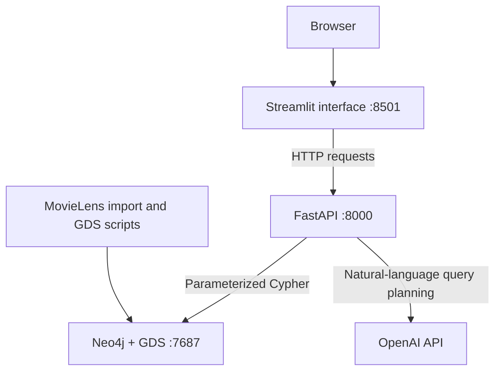
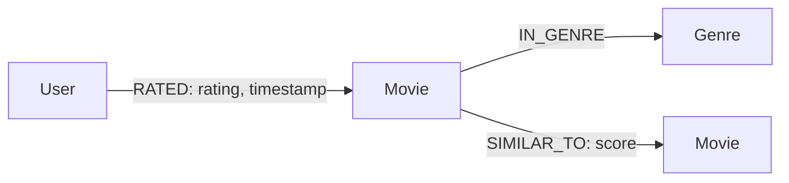
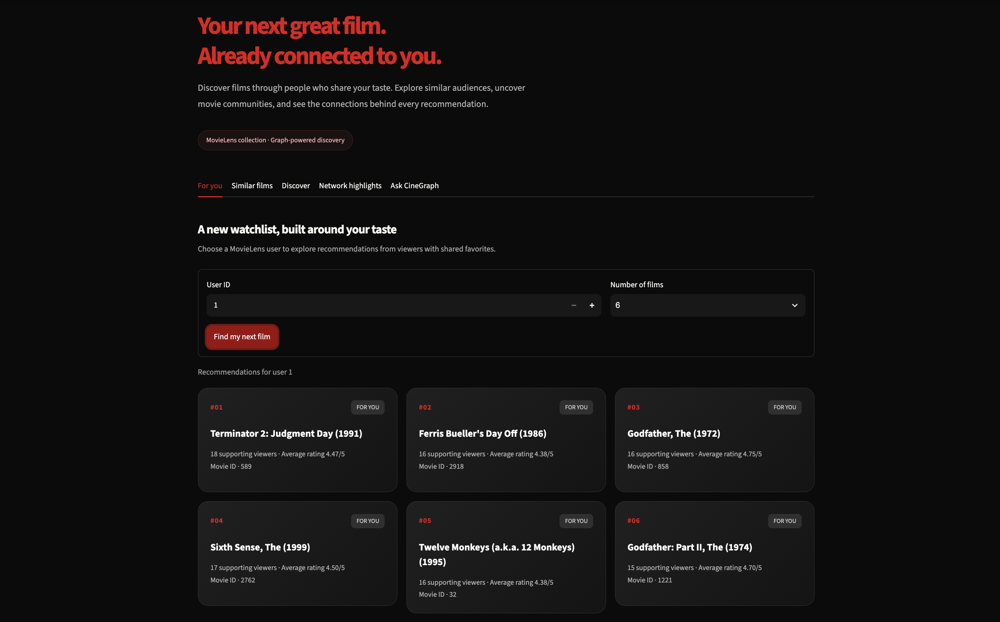
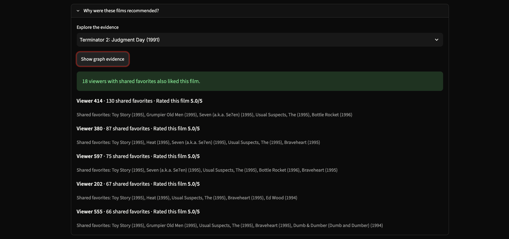
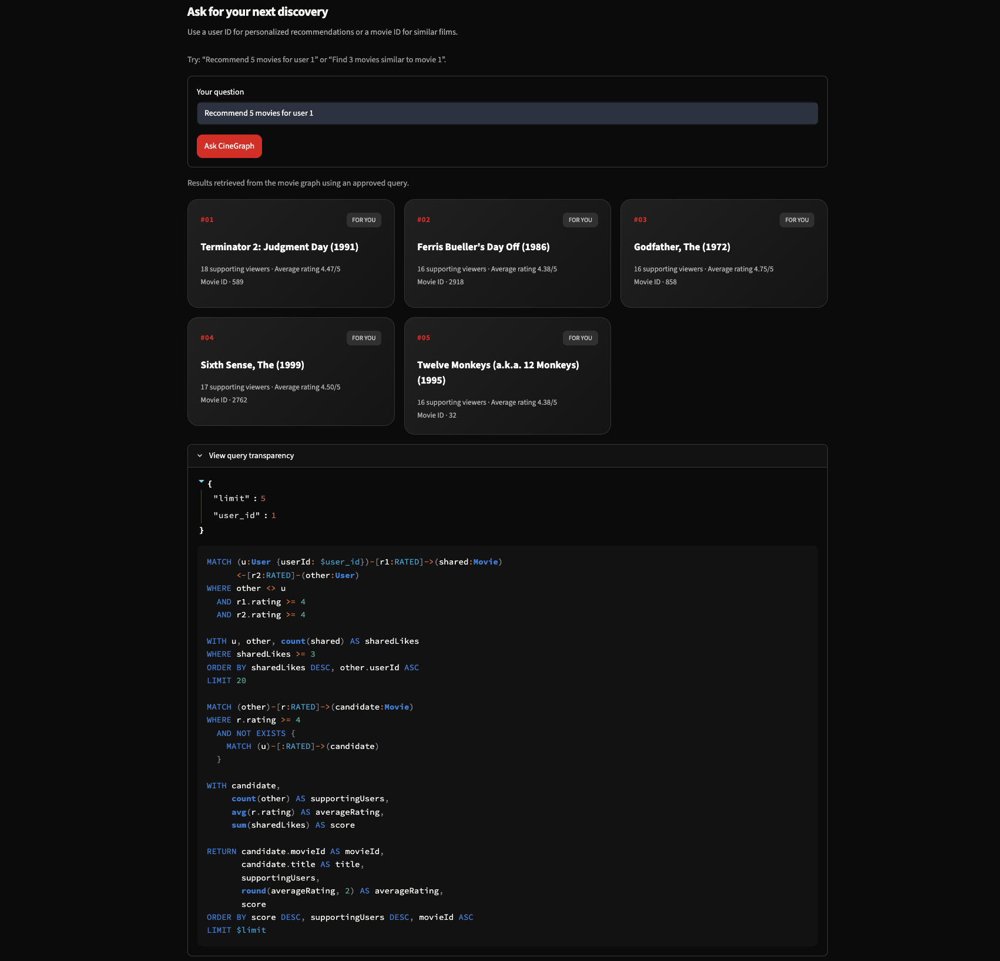

# CineGraph

[](https://github.com/adembennjima/cinegraph/actions)


Graph-based movie discovery using Neo4j, FastAPI, Streamlit, and MovieLens.

CineGraph recommends unseen films using viewers with shared favorites, finds movies with similar audiences, and explores movie communities. Recommendations include evidence from the graph.

## Features

- Personalized recommendations based on shared positive ratings.
- Recommendation explanations with supporting viewers and shared films.
- Similar movies using GDS Node Similarity and Jaccard similarity.
- Network centrality rankings using PageRank.
- Community discovery using Louvain.
- Natural-language requests translated into approved Cypher queries.
- API-key protection for the AI endpoint.
- Separate machine-learning experiment for hidden-link prediction.

## Architecture

Three services run through Docker Compose. Data setup and evaluation scripts run locally in Python.



The AI proposes a structured query plan. The backend validates it against an exact allowlist and executes the approved query with bound parameters. Movie results come from Neo4j.

## Graph model



| Element | Properties |
|---|---|
| User | `userId` |
| Movie | `movieId`, `title`, `year`, derived `pageRank`, derived `communityId` |
| Genre | `name` |
| RATED | `rating`, `timestamp` |
| IN_GENRE | Movie membership in a genre |
| SIMILAR_TO | Derived audience-similarity `score` |

Uniqueness constraints protect user IDs, movie IDs, and genre names. A separate index supports movie titles.

Genres are nodes because a movie can belong to multiple genres, and genre membership is a reusable relationship for graph traversal and future filtering.

Ratings remain relationship properties because each rating describes a particular user's interaction with a particular movie.

Similarity links are materialized to make movie discovery queries inexpensive. Their scores are derived and can be rebuilt from ratings.

## Dataset

Source: [GroupLens MovieLens small](https://grouplens.org/datasets/movielens/latest/).

The dataset used for this project contains:

- 9,742 movies.
- 610 users.
- 100,836 ratings.

The download includes the original dataset README and usage terms. Raw data is excluded from Git.

```bash
python -m scripts.download_data
```

The upstream `ml-latest-small` download can change. Counts and reported results describe the dataset used for this project.

## Requirements

- Python 3.12.
- Docker Desktop with Docker Compose.
- An OpenAI API key for natural-language requests.

The standard recommendation and discovery features do not require OpenAI.

## Installation

Clone the repository and enter it:

```bash
git clone https://github.com/adembennjima/cinegraph.git
cd cinegraph
```

Create and activate a virtual environment:

```bash
python3 -m venv .venv
source .venv/bin/activate
make install
```

Create the local configuration:

```bash
cp .env.example .env
```

Edit `.env`:

```dotenv
NEO4J_URI=bolt://localhost:7687
NEO4J_USER=neo4j
NEO4J_PASSWORD=choose_a_local_database_password
OPENAI_API_KEY=
OPENAI_MODEL=gpt-4.1-mini
APP_API_KEY=choose_a_random_application_key
```

Generate an application key locally if needed:

```bash
python -c "import secrets; print(secrets.token_urlsafe(32))"
```

Copy the generated value into `APP_API_KEY`. Add your OpenAI key to `OPENAI_API_KEY` to enable natural-language requests.

Keep `.env` private. Docker Compose supplies the necessary credentials to the services at runtime.

## Start the application

Start all three services:

```bash
make docker-run
```

Download the dataset, import the graph, and compute derived relationships and properties:

```bash
make setup-data
```

The setup command performs these steps in order:

1. Download missing MovieLens files.
2. Create constraints and indexes.
3. Import movies and genres.
4. Import users and ratings.
5. Build movie similarity links.
6. Compute PageRank.
7. Detect movie communities.

Imports use `MERGE` to avoid duplicating existing entities and relationships. Derived similarity links and community assignments are rebuilt.

Open:

- Interface: http://localhost:8501
- API documentation: http://localhost:8000/docs
- Neo4j Browser: http://localhost:7474

Check service status:

```bash
docker compose ps
```

Stop the services:

```bash
make docker-stop
```

The named Neo4j volume preserves database contents between container restarts.

## Try the interface

| Tab | Example |
|---|---|
| For you | User `1`, then find recommendations |
| Recommendation evidence | Select a recommended film and show graph evidence |
| Similar films | Movie `1`, which is Toy Story |
| Discover | User `1`, then explore community picks |
| Network highlights | Explore films ranked by PageRank |
| Ask CineGraph | `Recommend 5 movies for user 1` |

Other supported AI examples:

```text
Find 3 movies similar to movie 1
Recommend 5 movies for user 2
```

The current AI interface supports explicit numeric user or movie IDs. It supports two query templates: recommendations and similar movies.

Requests to modify data and queries outside the allowlist are rejected.

## API endpoints

| Method | Endpoint | Purpose |
|---|---|---|
| GET | `/health` | Application health |
| GET | `/health/database` | Database and GDS connectivity |
| GET | `/api/users/{user_id}/recommendations` | Personalized recommendations |
| GET | `/api/users/{user_id}/recommendations/{movie_id}/why` | Supporting graph evidence |
| GET | `/api/movies/{movie_id}/similar` | Similar movie audiences |
| GET | `/api/movies/trending` | Historical PageRank ranking |
| GET | `/api/users/{user_id}/discover` | Community-based discovery |
| POST | `/api/ask` | Guarded natural-language requests |

The `/api/ask` endpoint requires the `X-API-Key` header. Streamlit supplies it automatically from its server environment.

In Swagger, use **Authorize** with the application key before calling `/api/ask`.

Endpoints validate identifiers and result limits. Ranking and discovery endpoints support offset pagination. Unknown entities return `404`; invalid request parameters return `422`.

## Recommendation logic

A positive rating is a rating of at least 4 out of 5.

For personalized recommendations:

1. Find other users sharing at least three liked movies with the target user.
2. Keep up to 20 users with the most shared likes.
3. Find movies those users liked that the target user has never rated.
4. Rank candidates by the sum of shared-like counts across supporting users.

The recommendation score is a ranking score, not a probability or predicted rating.

The evidence endpoint returns supporting users, their shared-like counts, examples of shared movies, and their rating of the candidate.

## Graph algorithms

### Node Similarity

A projected graph connects movies to users who rated them at least 4.

GDS computes Jaccard audience similarity with:

- Minimum movie degree: 3.
- Minimum similarity: 0.1.
- Up to 10 outgoing similarity links per eligible movie.

The observed run compared 2,810 nodes and stored 28,100 `SIMILAR_TO` links.

Jaccard similarity is symmetric, but stored top-10 selections can produce directed links without a reverse counterpart.

### PageRank

Weighted PageRank runs on the directed movie similarity network.

The observed run converged after 83 iterations. The resulting scores measure network centrality, not movie quality, current popularity, or box-office performance.

### Louvain

Louvain detects communities in an undirected projection of connected movies. Reciprocal similarity links are combined using their maximum weight.

One observed run found 12 communities with modularity 0.5646. Community counts, assignments, and identifiers can vary between runs.

Discovery selects unseen films from the user's three most-liked communities and orders them by community preference, then PageRank. It does not guarantee equal representation of those communities.

## Machine-learning experiment

Run:

```bash
make ml
```

This separate experiment predicts hidden positive user–movie links using logistic regression.

The positive interactions are randomly divided into:

- 60% for the graph used to compute features.
- 20% for supervised training.
- 20% for held-out testing.

Features:

- User like degree.
- Movie like degree.
- Genre affinity.
- Three-hop user–movie path count.

Training and test links are excluded from the feature graph. Each positive example is paired with a distinct sampled unrated movie for the same user.

| Method | Test ROC-AUC | Test average precision |
|---|---:|---:|
| Movie popularity baseline | 0.8816 | 0.8845 |
| Logistic regression | 0.8999 | 0.9073 |

Results are saved in `reports/link_prediction_metrics.json`.

These metrics measure hidden-link recovery among sampled candidates. Unrated films are not confirmed dislikes, and the random split does not measure future viewing behavior.

The experiment does not replace the API's collaborative recommendation method.

## Query performance

Run:

```bash
make benchmark
```

The benchmark compares equivalent movie lookups using a forced label scan and the existing movie-ID index. It verifies identical results, warms both queries, alternates execution order, and measures 20 runs per query.

For a nonexistent movie ID, one local run produced:

| Method | Median client time | Database hits |
|---|---:|---:|
| Label scan | 4.317 ms | 19,485 |
| Unique index lookup | 1.043 ms | 1 |

The indexed lookup was approximately 4.1 times faster in that run.

This comparison uses query hints in an already-indexed database. It is not a physical before-and-after index migration. Results include client/network overhead and apply to this specific lookup.

Timings and `EXPLAIN`/`PROFILE` operators are saved in `reports/query_benchmark.json`.

## Tests and code quality

```bash
make test
make lint
```

The observed local test run passed 18 tests with approximately 78% backend coverage. The enforced minimum is 60%.

The last recorded local Pylint score was 9.71/10 before the latest authentication and setup additions. CI enforces a minimum score of 9.5/10 on the current code.

Tests cover API behavior, recommendation evidence, similarity results, validation, query guardrails, and API-key rejection. AI endpoint tests mock query generation and do not make paid OpenAI calls.

GitHub Actions installs dependencies, starts a fresh Neo4j database, builds the graph, runs lint and tests, and builds the application image.

## Live AI evaluation

Run manually with Docker running and OpenAI configured:

    python -m scripts.evaluate_ai

One recorded run passed 8 out of 8 cases:

- Three supported questions selected the expected query and parameters.
- Returned movies matched the corresponding direct API responses.
- Two questions without explicit IDs were rejected.
- Two modification requests were rejected.
- A request exceeding the allowed result limit was rejected.

Detailed outcomes are saved in `reports/ai_evaluation.json`.

This is a small, fixed evaluation set with one run per question.
It does not establish general reliability or recommendation quality.

## Useful commands

| Command | Action |
|---|---|
| `make help` | List commands |
| `make install` | Install dependencies |
| `make docker-run` | Build and start the services |
| `make docker-stop` | Stop the services |
| `make setup-data` | Download, import, and build the graph |
| `make test` | Run tests and enforce coverage |
| `make lint` | Enforce the Pylint score |
| `make ml` | Run the link-prediction experiment |
| `make benchmark` | Run the query benchmark |
| `make clean` | Remove caches and coverage output |

`make run` starts FastAPI locally for development. Stop the Docker API first to avoid a port-8000 conflict.

After changing application code, run `make docker-run` to rebuild the image and recreate the services.

## Limitations

- Recommendations use historical MovieLens profiles, not personal accounts.
- No onboarding or rating submission is implemented.
- Sparse audiences may have no stored similarity links.
- Community and centrality results depend on the selected graph and thresholds.
- The AI supports approved templates and explicit IDs rather than arbitrary Cypher.
- API-key authentication protects direct access to `/api/ask`; the local Streamlit interface is not a user-login system.
- Dependencies are currently installed from unpinned requirements.
- The project is a local academic prototype.

## Interface screenshots

### Personalized recommendations



### Supporting graph evidence



### Natural-language query transparency



## Published Docker image

Image: [adembennjima/cinegraph](https://hub.docker.com/r/adembennjima/cinegraph)

Version `1.0.0` supports `linux/amd64` and `linux/arm64`.

Download it with:

    docker pull adembennjima/cinegraph:1.0.0

The image contains the FastAPI application, Streamlit interface,
and Python scripts. Its default command starts FastAPI.

Neo4j runs separately. Database contents and private credentials
are not included in the image.

The documented Docker Compose setup builds the application locally.
See [Graph modeling decisions and schema comparison](docs/modeling.md).

## Author and development history

Individual project by Adem Ben Njima.

- [Merged implementation pull request](https://github.com/adembennjima/cinegraph/pulls)
- [Commit history](https://github.com/adembennjima/cinegraph/commits/main)

The pull request includes two post-merge self-review notes prepared
with AI assistance.